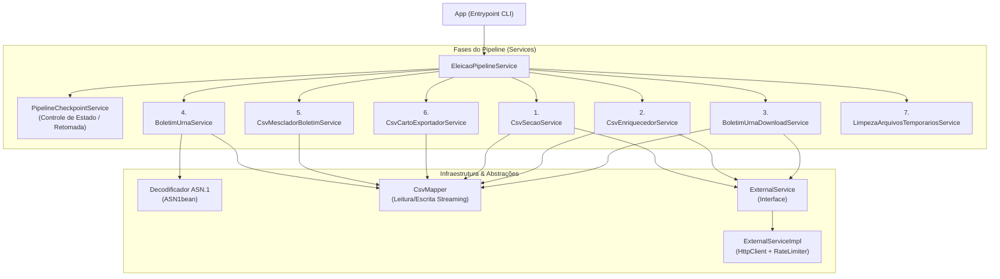
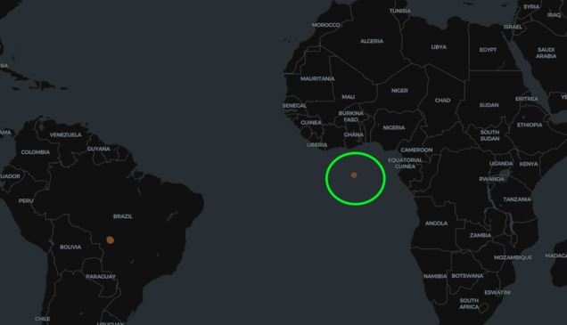
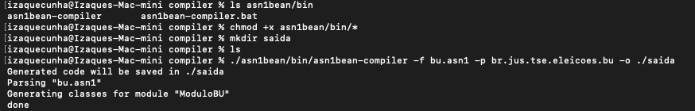

# 🗳️ Coleta de Votos TSE 2026 (`coleta-votos`)

Ferramenta de **ETL (Extract, Transform, Load)** em linha de comando desenvolvida em **Java 25** para extrair, decodificar, enriquecer e georreferenciar os votos de Boletins de Urna (BUs) da eleição presidencial diretamente da API oficial do **Tribunal Superior Eleitoral (TSE)**.

Ao final da execução, o sistema gera um dataset consolidado em CSV (`carto-dataset-final-eleic-presi-2026-1-turn-<uf>.csv`), cruzando os votos apurados em cada seção com suas coordenadas geográficas (`LATITUDE` e `LONGITUDE`), bairro e local de votação, pronto para visualização no **Carto.com**.

---

## 🏗️ Arquitetura e Fluxo Geral

O diagrama abaixo apresenta a visão geral da arquitetura, dividida entre o ponto de entrada (`App`), a orquestração das **fases do pipeline** (com suporte a checkpoint) e a camada de **infraestrutura**:



---

## 🔄 Como Funciona (As 7 Fases do Pipeline)

O `EleicaoPipelineService` coordena a execução sequencial das 7 etapas:

1. **Estrutura de Seções (`CsvSecaoService`):** Consulta o JSON de configuração estadual na API do TSE via streaming, filtra o município desejado e gera o CSV inicial (`temp.csv`) com todas as zonas e seções eleitorais.
2. **Enriquecimento de Metadados (`CsvEnriquecedorService`):** Consulta em paralelo os metadados de cada seção na API do TSE para obter o `hash` e o nome do arquivo de urna (`bu` ou `busa`), gerando o `arquivo-enriquecido.csv`. Seções que retornam HTTP 404 são marcadas como `inoperante/agregada`.
3. **Download dos Boletins de Urna (`BoletimUrnaDownloadService`):** Baixa concorrentemente os arquivos binários (`.dat`) das seções ativas para `temp-files/boletins-urnas/`, respeitando o limite de taxa (`RateLimiter`) e reaproveitando arquivos íntegros já existentes no disco.
4. **Decodificação e Apuração de Votos (`BoletimUrnaService` + `CsvBoletimUrnaService`):** Lê os arquivos binários `.dat`, decodifica a estrutura criptográfica **ASN.1 (BER)** da urna eletrônica, filtra os votos para o cargo de **Presidente** e exporta o resultado para `arquivo-boletim-urna.csv`.
5. **Mesclagem de Votos com Seções (`CsvMescladorBoletimService`):** Une os votos apurados na Fase 4 com os dados territoriais da Fase 2 através do identificador do boletim de urna, gerando o `resultado-mesclado.csv`.
6. **Exportação Georreferenciada (`CsvCartoExportadorService`):** Cruza os votos mesclados com a base de locais de votação do TSE (pela chave normalizada `UF-MUNICIPIO-ZONA-SECAO`), adicionando bairro, local de votação, latitude e longitude no dataset final `carto-dataset-final-eleic-presi-2026-1-turn-<uf>.csv`.
7. **Limpeza de Temporários (`LimpezaArquivosTemporariosService`):** Remove recursivamente a pasta `temp-files/` ao concluir o processamento com sucesso (comportamento configurável via CLI).

---

## 🛡️ Sistema de Checkpoint e Retomada Automática

Coletar dados de municípios grandes (como capitais) exige milhares de requisições HTTP ao TSE. Caso ocorra queda de internet, *timeout* ou interrupção manual no meio do processo, o software **não precisa recomeçar do zero**:

- **Checkpoint de Fases (`PipelineCheckpointService`):** Ao final de cada etapa (Fases 1 a 6), o progresso é salvo atomicamente no arquivo `temp-files/checkpoint-status.json`. Na próxima execução para o mesmo município, o pipeline verifica quais etapas já constam como concluídas e valida se os respectivos arquivos intermediários existem no disco com tamanho maior que zero, pulando as fases já prontas.
- **Reaproveitamento de Boletins Baixados (Fase 3):** Se o download dos arquivos `.dat` falhar na metade (ex: baixou 3.000 de 5.000 urnas), ao rodar novamente o `BoletimUrnaDownloadService` verifica os arquivos `.dat` íntegros já salvos em `temp-files/boletins-urnas/` e baixa apenas os 2.000 restantes.
- **Invalidação Automática de Contexto:** Se você iniciar uma execução para outro município ou UF diferente do que estava salvo no `checkpoint-status.json`, o checkpoint anterior é descartado automaticamente.

---

## 📍 Onde Obter os Dados de Entrada

Para rodar o programa (ou construir sua própria solução), você precisará de duas informações:

1. **Código TSE do Município (`<CODIGO_MUNICIPIO>`):**
    - Acesse a URL de configuração do estado trocando a sigla da UF (em minúsculas):
      `https://resultados.tse.jus.br/oficial/ele2026/arquivo-urna/3220/config/pr/pr-p003220-cs.json`
    - Pesquise (`Ctrl+F`) pelo nome da cidade (ex: `"CURITIBA"` ou `"ADRIANÓPOLIS"`) e copie o valor do campo `"cd"` logo acima dele (ex: `"75353"` ou `"74039"`).

2. **Arquivo CSV de Coordenadas (`<CAMINHO_ARQUIVO_COORDENADAS>`):**
    - Acesse o Portal de Dados Abertos do TSE em:
      👉 **[https://dadosabertos.tse.jus.br/dataset/eleitorado-2026](https://dadosabertos.tse.jus.br/dataset/eleitorado-2026)**
    - Baixe o pacote **"Eleitorado por local de votação - 2026"** e extraia o arquivo CSV correspondente ao estado desejado (ex: `eleitorado_local_votacao_2026_PR.csv`).
    - *Observação técnica:* O arquivo bruto do TSE é distribuído em codificação **`ISO-8859-1` (Latin-1)**, separador **`;`** e utiliza vírgula como separador decimal nas colunas `NR_LATITUDE` e `NR_LONGITUDE` (ex: `-25,4759288`).

---

## 🛠️ Stack Técnica deste Repositório

- **Linguagem:** Java 25
- **Build & Empacotamento:** Apache Maven (`maven-shade-plugin` para geração de *Fat JAR*)
- **Injeção de Dependências:** Google Dagger 2 (`2.59.1`)
- **Processamento de JSON e CSV:** Jackson 3.x (`tools.jackson` `3.2.3`) com API de Streaming
- **Decodificação Binária (Urna):** `com.beanit:asn1bean` (`1.16.0`)
- **Resiliência de Rede:** `java.net.http.HttpClient` (HTTP/2) + Resilience4j `RateLimiter` (`2.2.0`)
- **Logging:** SLF4J + Logback
- **Testes:** JUnit 5 + Mockito

---

## 🚀 Como Compilar e Executar

### Pré-requisitos
- **JDK 25** e **Maven 3.9+** instalados.
- Arquivo CSV de locais de votação/coordenadas do TSE baixado do portal de Dados Abertos.

### 1. Compilar, testar e gerar o JAR
```bash
# Executar os testes unitários
mvn test

# Gerar o Fat JAR executável (target/coleta-votos.jar)
mvn clean package
```

### 2. Executar o pipeline
```bash
java -jar target/coleta-votos.jar <UF> <CODIGO_MUNICIPIO> <CAMINHO_ARQUIVO_COORDENADAS> [LIMPAR_ARQUIVOS_TEMPORARIOS]
```

**Exemplo padrão (Curitiba/PR — código TSE `75353`), limpando os arquivos temporários ao final:**
```bash
java -jar target/coleta-votos.jar PR 75353 ./dados/eleitorado_local_votacao_2026_PR.csv
```

**Exemplo preservando a pasta `temp-files/` para inspeção ou depuração (`false` no último argumento):**
```bash
java -jar target/coleta-votos.jar PR 75353 ./dados/eleitorado_local_votacao_2026_PR.csv false
```

---

## 📊 Estrutura do CSV Final e Consultas no Carto (`query-carto.sql`)

O arquivo gerado (`carto-dataset-final-eleic-presi-2026-1-turn-<uf>.csv`) possui codificação `UTF-8`, separador `,` e as seguintes colunas:

| Coluna | Descrição | Exemplo |
| :--- | :--- | :--- |
| `SG_UF` | Sigla da Unidade Federativa | `PR` |
| `CD_MUNICIPIO` | Código TSE do Município | `74039` |
| `NM_MUNICIPIO` | Nome do Município | `ADRIANÓPOLIS` |
| `NR_ZONA` | Número da Zona Eleitoral | `0048` |
| `NR_SECAO` | Número da Seção Eleitoral | `0001` |
| `NM_BAIRRO` | Bairro do local de votação | `CENTRO` |
| `NM_LOCAL_VOTACAO` | Nome da escola/local de votação | `COLÉGIO ESTADUAL...` |
| `LATITUDE` | Latitude em formato decimal com ponto | `-24.6572112` |
| `LONGITUDE` | Longitude em formato decimal com ponto | `-48.9912345` |
| `CANDIDATO` | Número do candidato, `BRANCO` ou `NULO` | `13`, `22`, `BRANCO`, `NULO` |
| `QTD_VOTOS` | Quantidade de votos na seção | `184` |
| `BOLETIM_URNA` | Nome do arquivo `.dat` de origem | `o03220pr7403900480001-bu.dat` |

### Uso do arquivo `query-carto.sql`
O repositório inclui o arquivo [`query-carto.sql`](./query-carto.sql) com consultas SQL prontas para serem utilizadas no **Carto.com / BigQuery** após importar os CSVs gerados:
- Agrupa todas as seções por **local de votação** (`nm_municipio`, `nm_local_votacao`, `nm_bairro`).
- Transforma as linhas de candidatos em colunas (`votos_22`, `votos_13`, `votos_branco`, `votos_nulo`, etc.).
- Une tabelas de múltiplas capitais (`UNION ALL`) e calcula automaticamente o candidato **vencedor** em cada local de votação.

> [!WARNING]
> **Atenção — Inconsistências nas Coordenadas Oficiais do TSE:**
> Conforme documentado nos comentários ao final do arquivo [`query-carto.sql`](./query-carto.sql), a planilha oficial de locais de votação fornecida pelo TSE apresenta **coordenadas geográficas inconsistentes, deslocadas ou ausentes** para determinados locais de votação (especialmente unidades prisionais/Fundação CASA, votos em trânsito e algumas escolas em estados como `SP`, `RS`, `BA`, `PE`, `PB`, `CE`, `PA`, `AP`, `RR` e `MT`), fazendo com que pontos apareçam fora dos limites do município ou em locais incorretos no mapa:
>
> 

---

## 🌐 Guia da API do TSE (Para Implementação em Outras Linguagens)

Caso queira implementar este coletor em outra linguagem (Python, Go, Node.js, Rust, etc.), toda a comunicação com o TSE é feita via requisições `HTTP GET` públicas utilizando 3 endpoints em sequência.

> [!IMPORTANT]
> **Documentação Oficial do TSE (Fonte Primária):**
> As especificações de rotas, códigos de pleito, layouts JSON e gramáticas ASN.1 podem sofrer atualizações a cada eleição. Sempre tome como referência oficial as páginas mantidas pelo próprio Tribunal Superior Eleitoral:
> - 📘 **[Informações Técnicas sobre a Divulgação de Resultados (TSE)](https://www.tse.jus.br/eleicoes/informacoes-tecnicas-sobre-a-divulgacao-de-resultados)** *(documentação oficial dos endpoints, rotas e estruturas JSON)*
> - 🗳️ **[Portal Oficial das Eleições 2026 (TSE)](https://www.tse.jus.br/eleicoes/eleicoes-2026)** *(onde pode ser encontrado o arquivo de especificação `bu.asn1` e artefatos da eleição de 2026)*

### Parâmetros Base do TSE (1º Turno 2026)
- **`BASE_URL`**: `https://resultados.tse.jus.br/oficial`
- **`CICLO`**: `ele2026`
- **`PLEITO`**: `3220` *(código do 1º turno de 2026)*
- **`UF`**: sigla do estado em **letras minúsculas** (ex: `pr`, `sp`, `rj`)

---

### Passo 1: Obter Zonas e Seções do Município (`-cs.json`)
- **URL Padrão:**
  ```text
  https://resultados.tse.jus.br/oficial/{CICLO}/arquivo-urna/{PLEITO}/config/{UF}/{UF}-p00{PLEITO}-cs.json
  ```
- **Exemplo real (Paraná - `pr`):**
  https://resultados.tse.jus.br/oficial/ele2026/arquivo-urna/3220/config/pr/pr-p003220-cs.json *(basta trocar `pr` pela UF desejada na URL)*
- **Exemplo do JSON retornado:**
  Dentro do array `"abr"`, a chave `"mu"` lista os municípios do estado com seu código TSE (`"cd"`), nome (`"nm"`), zonas (`"zon"`) e seções (`"sec"`). Repare que seções agregadas aparecem indicadas com `"nsp"` (número da seção principal onde foi agregada, como a seção `0085` agregada na `0006`):
  ```json
  {
    "dg": "05/10/2026",
    "hg": "02:59:38",
    "idg": "2778778",
    "f": "o",
    "cdp": "3220",
    "abr": [
      {
        "cd": "pr",
        "ds": "PARANÁ",
        "mu": [
          {
            "cd": "74039",
            "nm": "ADRIANÓPOLIS",
            "zon": [
              {
                "cd": "0048",
                "sec": [
                  {
                    "ns": "0001",
                    "da": "04/10/2026",
                    "ha": "22:44:53"
                  },
                  {
                    "ns": "0006",
                    "nsa": ["0085"],
                    "da": "04/10/2026",
                    "ha": "22:44:10"
                  },
                  {
                    "ns": "0085",
                    "nsp": "0006"
                  }
                ]
              }
            ]
          }
        ]
      }
    ]
  }
  ```

---

### Passo 2: Obter o Hash e Nome do Arquivo da Seção (`-aux.json`)
Para cada seção obtida no Passo 1, consulta-se o arquivo auxiliar daquela seção:
- **URL Padrão:**
  ```text
  https://resultados.tse.jus.br/oficial/{CICLO}/arquivo-urna/{PLEITO}/dados/{UF}/{COD_MUNICIPIO}/{ZONA}/{SECAO}/p00{PLEITO}-{UF}-m{COD_MUNICIPIO}-z{ZONA}-s{SECAO}-aux.json
  ```
  *(Nota: `{ZONA}` e `{SECAO}` possuem 4 dígitos com zeros à esquerda, ex: `0048` e `0001`).*
- **Exemplo real (Adrianópolis `74039`, Zona `0048`, Seção `0001`):**
  ```text
  https://resultados.tse.jus.br/oficial/ele2026/arquivo-urna/3220/dados/pr/74039/0048/0001/p003220-pr-m74039-z0048-s0001-aux.json
  ```
- **Exemplo do JSON retornado:**
  Procure no array `"hashes"` o arquivo (`"arq"`) cujo tipo (`"tp"`) seja `"bu"` (Boletim de Urna) ou `"busa"` (Boletim de Urna do Sistema de Apuração):
  ```json
  {
    "dg": "05/10/2026",
    "hg": "12:54:55",
    "idg": "3180062",
    "f": "o",
    "st": "Totalizada",
    "hashes": [
      {
        "hash": "657748492b31494a742d6b394741424e6c79644c45772b74476761547032332b585a57636f434b324d4c553d",
        "dr": "04/10/2026",
        "hr": "17:52:44",
        "st": "Totalizado",
        "arq": [
          {
            "nm": "o03220pr7403900480001-vota.vsc",
            "tp": "vota"
          },
          {
            "nm": "o03220pr7403900480001-log.jez",
            "tp": "log"
          },
          {
            "nm": "o03220pr7403900480001-rdv.dat",
            "tp": "rdv"
          },
          {
            "nm": "o03220pr7403900480001-bu.dat",
            "tp": "bu"
          }
        ]
      }
    ]
  }
  ```
  > **Atenção ao HTTP 404:** Se esta URL retornar `404 Not Found` (como ocorre para a seção agregada `0085` do exemplo acima), significa que a seção foi **agregada a outra ou ficou inoperante**. Basta ignorá-la e seguir para a próxima.

---

### Passo 3: Baixar e Decodificar o Boletim de Urna Binário (`.dat`)
Com o `hash` e o nome do arquivo (`nm`) de tipo `"bu"` obtidos no Passo 2, baixa-se o binário da urna:
- **URL Padrão:**
  ```text
  https://resultados.tse.jus.br/oficial/{CICLO}/arquivo-urna/{PLEITO}/dados/{UF}/{COD_MUNICIPIO}/{ZONA}/{SECAO}/{HASH}/{NOME_ARQUIVO_BU}
  ```
- **Exemplo real (Adrianópolis `74039`, Zona `0048`, Seção `0001`):**
  ```text
  https://resultados.tse.jus.br/oficial/ele2026/arquivo-urna/3220/dados/pr/74039/0048/0001/657748492b31494a742d6b394741424e6c79644c45772b74476761547032332b585a57636f434b324d4c553d/o03220pr7403900480001-bu.dat
  ```

#### Como o arquivo `bu.asn1` foi compilado e decodificado em Java
O arquivo `.dat` é binário e segue a especificação **ASN.1 BER** definida pelo arquivo **`bu.asn1`** (disponível na página das [Eleições 2026 do TSE](https://www.tse.jus.br/eleicoes/eleicoes-2026)).

Neste projeto Java, a decodificação é realizada utilizando a biblioteca **`com.beanit:asn1bean`**. As classes Java de modelo (`model/tse/asn1/*`) foram geradas a partir do arquivo `bu.asn1` utilizando o compilador de linha de comando **`asn1bean-compiler`**:

```bash
chmod +x asn1bean/bin/*
mkdir saida
./asn1bean/bin/asn1bean-compiler -f bu.asn1 -p br.jus.tse.eleicoes.bu -o ./saida
```



Com as classes geradas (ou utilizando um parser ASN.1 equivalente na sua linguagem, como `asn1tools` em Python), o fluxo de leitura do arquivo `.dat` segue 4 passos:
1. Decodifique o envelope externo (`EntidadeEnvelopeGenerico`) e extraia os bytes do campo `conteudo` (`OCTET STRING`).
2. Decodifique esses bytes usando a estrutura `EntidadeBoletimUrna`.
3. Percorra `resultadosVotacaoPorEleicao` $\rightarrow$ `resultadosVotacao` $\rightarrow$ `totaisVotosCargo`, filtrando onde `codigoCargo.cargoConstitucional == 1` (**Presidente**).
4. Em `votosVotaveis`, leia `tipoVoto` (`1` = Nominal, `2` = Branco, `3` = Nulo), `quantidadeVotos` e `identificacaoVotavel.codigo` (número do candidato).